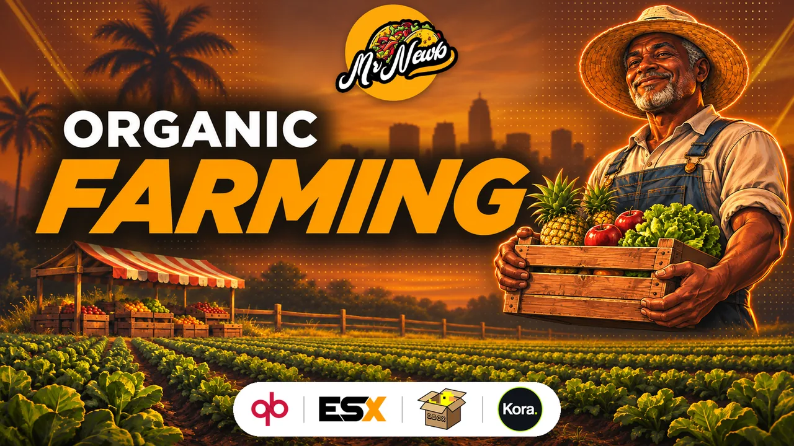
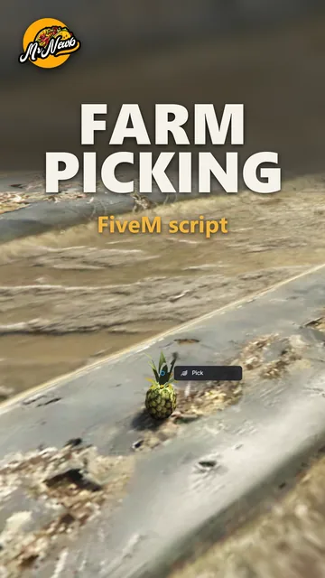

# MrNewbOrganics



Fruit and vegetable picking plus farmers market vendors.

[Documentation](https://mrnewb.github.io/docs/mrnewborganics) | [Install guide](https://mrnewb.github.io/docs/mrnewborganics/install) | [Tebex](https://mrnewbscripts.tebex.io/) | [Discord](https://discord.gg/mrnewbscripts) | [Short](https://www.youtube.com/shorts/xKjmfgxqe3U)

<a href="https://www.youtube.com/shorts/xKjmfgxqe3U"></a>

<p>
  
  
  
</p>

## Features

- Harvest sites as sphere zones or spawned props
- One map blip per pick type (first location only)
- Per-type reward item, animation, and optional world prop
- Farmers market peds that buy produce for **bank**
- 60s pick cooldown per player per site
- Everything in one file: `resource/open/shared/config.lua`

Shipped produce: `apple`, `pineapple`, `lettuce`.

## Install

Needs [ox_lib](https://github.com/overextended/ox_lib) and [Newb_Bridge](https://github.com/MrNewb/Newb_Bridge). Item paste and images: [install guide](https://mrnewb.github.io/docs/mrnewborganics/install).

```cfg
ensure ox_lib
ensure Newb_Bridge
ensure MrNewbOrganics
```

Copy `[install]/images/` into your inventory images folder. Register `apple`, `pineapple`, and `lettuce`. These items are not usable.

## Config

`resource/open/shared/config.lua`:

- `Config.PickingTypes` - sites, rewards, animations. `propModel` spawns a prop; omit it for a sphere zone
- `Config.FarmersMarket` - vendor peds, blips, and sell prices (item to bank amount)

Field tables: [documentation](https://mrnewb.github.io/docs/mrnewborganics).
